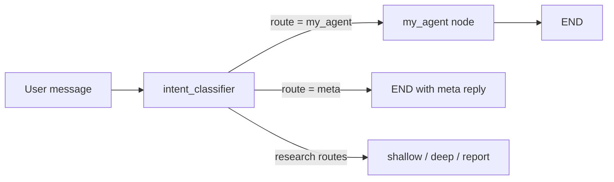

<!--
SPDX-FileCopyrightText: Copyright (c) 2026, NVIDIA CORPORATION & AFFILIATES. All rights reserved.
SPDX-License-Identifier: Apache-2.0
-->

# Adding a New Agent

This guide walks through adding a new agent end-to-end: building it as a NeMo
Agent Toolkit function, running it on its own, and connecting it to the chat
pipeline so the intent classifier can route requests to it.

The reference implementation is the NVIDIA joke agent at
`src/deep_researcher_agent/agents/nvidia_joke/`, which answers "tell me a joke"
requests with an NVIDIA-themed joke. Every code block in this guide is adapted
from it. When a step is unclear, compare it with the matching joke-agent file.

Throughout the guide, `my_agent` is the placeholder name. Replace it
consistently:

| Placeholder | Meaning | Joke-agent equivalent |
|---|---|---|
| `my_agent` | Package directory, NAT type name, route name, and workflow setting | `nvidia_joke`, `nvidia_joke_agent`, `nvidia_joke` |
| `MyAgent` | Agent class | `NvidiaJokeAgent` |
| `MyAgentState` | State model | `NvidiaJokeAgentState` |
| `MyAgentConfig` | NAT config class | `NvidiaJokeAgentConfig` |
| `my_agent_route_enabled` | Classifier availability flag | `nvidia_joke_route_enabled` |
| `my_agent_fn` | Orchestrator constructor argument | `nvidia_joke_fn` |

The guide has three parts:

- **Part 1 (Steps 1–8):** Build the agent and run it standalone.
- **Part 2 (Steps 9–15):** Add a route so the chat pipeline sends requests to it.
- **Part 3 (Steps 16–17):** Test the route and run it end-to-end.

You can stop after Part 1 if you only need a standalone agent.

---

## Prerequisites

- The repository is set up (`./scripts/setup.sh`) and you can run
  `uv run pytest` from the repository root.
- `deploy/.env` contains a working `NVIDIA_API_KEY` (or keys for whichever LLM
  provider you configure).
- You can run the existing CLI pipeline:

  ```bash
  dotenv -f deploy/.env run nat run --config_file configs/config_cli_default.yml --input "Hello"
  ```

- Basic familiarity with NeMo Agent Toolkit's `@register_function` decorator and
  YAML configuration. Refer to [Adding a Tool](./adding-a-tool.md) for an
  introduction.

---

## Part 1: Build the Agent

### Step 1: Create the Package

Agents live under `src/deep_researcher_agent/agents/`, one package per agent.
They are part of the main `deep_researcher_agent` package, unlike tools, which
are separate packages under `sources/`.

```
src/deep_researcher_agent/agents/my_agent/
    __init__.py          # Imports register so NAT loads the plugin
    agent.py             # Agent logic
    register.py          # NAT config classes and @register_function
    models/
        __init__.py
        state.py         # Input/output state model
    prompts/
        system.j2        # System prompt (Jinja2)
```

```bash
mkdir -p src/deep_researcher_agent/agents/my_agent/{models,prompts}
mkdir -p tests/deep_researcher_agent/agents/my_agent
```

Every Python file starts with the SPDX license header used across the
repository. Copy it from any existing file, for example
`src/deep_researcher_agent/agents/nvidia_joke/agent.py`. The `pre-commit`
hooks check for it.

---

### Step 2: Define the State Model

The state model is the agent's input and output. The `messages` field holds the
conversation; `add_messages` is the LangGraph reducer that appends new messages.
Add more fields only if the agent needs them (refer to
`agents/shallow_researcher/models/state.py` for a richer example with
`data_sources` and `available_documents`).

```python
# src/deep_researcher_agent/agents/my_agent/models/state.py

"""State models for my agent."""

from typing import Annotated

from langchain_core.messages import AnyMessage
from langgraph.graph.message import add_messages
from pydantic import BaseModel


class MyAgentState(BaseModel):
    """
    State for my agent.

    Attributes:
        messages: Conversation history with LangGraph message reducer.
    """

    messages: Annotated[list[AnyMessage], add_messages]
```

```python
# src/deep_researcher_agent/agents/my_agent/models/__init__.py

"""State models for my agent."""

from .state import MyAgentState

__all__ = [
    "MyAgentState",
]
```

---

### Step 3: Write the Prompt

Prompts are Jinja2 templates stored next to the agent. Keep behavior in the
prompt rather than in Python so it can be changed without code changes.
Describe both what the agent does and what it does when the request is outside
its scope.

```jinja
{# src/deep_researcher_agent/agents/my_agent/prompts/system.j2 #}
You are <Agent Name>. Your only job is <what the agent does>.

## When the user asks for <the thing>
<Instructions for the response: format, length, tone, constraints.>

## Otherwise
If the latest message does not ask for <the thing>, briefly say what you can do
and invite the user to ask for it. Do not answer the unrelated request.
```

For a complete example, refer to `agents/nvidia_joke/prompts/joke.j2`.

---

### Step 4: Implement the Agent

The agent class holds the LLM and prompt and exposes one `async def run(state)`
method. This minimal version makes a single LLM call. For tool calling or
multi-step flows, build a LangGraph graph inside the class as
`agents/shallow_researcher/agent.py` does.

```python
# src/deep_researcher_agent/agents/my_agent/agent.py

"""My agent: <one-line description>."""

import logging
from pathlib import Path

from langchain_core.language_models import BaseChatModel
from langchain_core.messages import AIMessage
from langchain_core.messages import SystemMessage

from deep_researcher_agent.common import load_prompt

from .models import MyAgentState

logger = logging.getLogger(__name__)

AGENT_DIR = Path(__file__).parent


class MyAgent:
    """Single-call agent that <does the thing>."""

    def __init__(self, llm: BaseChatModel, max_history: int = 10):
        self.llm = llm
        self.max_history = max_history
        self.system_prompt = load_prompt(AGENT_DIR / "prompts", "system")

    async def run(self, state: MyAgentState) -> MyAgentState:
        """Generate a reply to the latest user message."""
        history = state.messages[-self.max_history :] if self.max_history > 0 else state.messages
        response = await self.llm.ainvoke([SystemMessage(content=self.system_prompt), *history])
        content = response.content if isinstance(response.content, str) else str(response.content)
        return MyAgentState(messages=[*state.messages, AIMessage(content=content.strip())])
```

`load_prompt` resolves `"system"` to `prompts/system.j2`. If your prompt needs
variables, render it with `render_prompt_template(template, **kwargs)` from
`deep_researcher_agent.common`.

---

### Step 5: Register the Agent with NeMo Agent Toolkit

`register.py` defines two NAT functions:

- **`my_agent`** — the agent itself. It takes and returns `MyAgentState`. The
  chat pipeline calls this one.
- **`my_agent_workflow`** — a thin wrapper that takes a plain string and returns
  a `ChatResponse`, so you can run the agent on its own with `nat run` or
  `nat eval`.

The `name=` on each config class becomes the `_type` used in YAML, so it must be
unique across the project.

```python
# src/deep_researcher_agent/agents/my_agent/register.py

"""NAT register function for my agent."""

import logging

from langchain_core.messages import HumanMessage
from pydantic import Field

from deep_researcher_agent.common import _create_chat_response
from deep_researcher_agent.relay.bootstrap import ensure_started as _ensure_relay_started
from deep_researcher_agent.relay.config import RelayConfig
from nat.builder.builder import Builder
from nat.builder.framework_enum import LLMFrameworkEnum
from nat.builder.function_info import FunctionInfo
from nat.cli.register_workflow import register_function
from nat.data_models.api_server import ChatResponse
from nat.data_models.component_ref import LLMRef
from nat.data_models.function import FunctionBaseConfig

from .agent import MyAgent
from .models import MyAgentState

logger = logging.getLogger(__name__)


class MyAgentConfig(FunctionBaseConfig, name="my_agent"):
    """Configuration for my agent."""

    llm: LLMRef = Field(..., description="LLM to use")
    max_history: int = Field(default=10, description="Maximum number of recent messages sent to the LLM")


@register_function(config_type=MyAgentConfig, framework_wrappers=[LLMFrameworkEnum.LANGCHAIN])
async def my_agent(config: MyAgentConfig, builder: Builder):
    """My agent."""
    llm = await builder.get_llm(config.llm, wrapper_type=LLMFrameworkEnum.LANGCHAIN)
    agent = MyAgent(llm=llm, max_history=config.max_history)

    async def _run(state: MyAgentState) -> MyAgentState:
        return await agent.run(state)

    yield FunctionInfo.from_fn(_run, description="<One-line description of my agent.>")


class MyAgentWorkflowConfig(FunctionBaseConfig, name="my_agent_workflow"):
    """Standalone wrapper that accepts a string query and calls my_agent."""

    relay: RelayConfig = Field(default_factory=RelayConfig, description="NeMo Relay plugins and export destinations")


@register_function(config_type=MyAgentWorkflowConfig, framework_wrappers=[LLMFrameworkEnum.LANGCHAIN])
async def my_agent_workflow(config: MyAgentWorkflowConfig, builder: Builder):
    """Wrapper workflow that accepts string queries."""
    await _ensure_relay_started(config.relay)
    my_agent_fn = await builder.get_function("my_agent")
    workflow_id = config.name or config.type

    async def _run(query: str) -> ChatResponse:
        result = await my_agent_fn.ainvoke(MyAgentState(messages=[HumanMessage(content=query)]))
        return _create_chat_response(result.messages[-1].content, response_id="my_agent_response", model=workflow_id)

    yield FunctionInfo.from_fn(_run, description="My agent workflow (accepts string query).")
```

Then make the package import `register` so NAT loads both functions:

```python
# src/deep_researcher_agent/agents/my_agent/__init__.py

"""My agent."""

from . import register  # noqa: F401
from .register import my_agent  # noqa: F401
from .register import my_agent_workflow  # noqa: F401

__all__ = [
    "my_agent",
    "my_agent_workflow",
]
```

```{note}
If the agent needs research tools, follow `agents/shallow_researcher/register.py`:
add `tools` and `exclude_tools` fields, resolve them with `builder.get_tools(...)`,
and filter them per request with `filter_tools_by_sources`.
```

---

### Step 6: Add the Plugin Entry Point

NAT discovers plugins through entry points. Add one line to the root
`pyproject.toml`, under the existing agent entries:

```toml
[project.entry-points."nat.plugins"]
# ...existing entries...
deep_researcher_my_agent = "deep_researcher_agent.agents.my_agent.register"
```

Reinstall so the entry point is registered, then confirm NAT sees both types:

```bash
uv sync --group dev
uv run nat info components -t function | grep my_agent
```

You should see `my_agent` and `my_agent_workflow`. If they are missing, check
the entry-point path and that `uv sync` succeeded.

---

### Step 7: Create a Standalone Config

Create a small config that runs only your agent. It needs an LLM, the agent
function, and the workflow wrapper.

```yaml
# configs/config_cli_my_agent.yml
# Usage:
#   dotenv -f deploy/.env run nat run --config_file configs/config_cli_my_agent.yml --input "..."

general:
  telemetry:
    logging:
      console:
        _type: console
        level: INFO

llms:
  my_agent_llm:
    _type: nim
    model_name: nvidia/nemotron-3.5-lightning-30b-a3b
    base_url: "https://integrate.api.nvidia.com/v1"
    api_key: ${NVIDIA_API_KEY}
    temperature: 0.2
    top_p: 0.9
    max_tokens: 512
    num_retries: 5
    chat_template_kwargs:
      enable_thinking: false

functions:
  my_agent:
    _type: my_agent
    llm: my_agent_llm

workflow:
  _type: my_agent_workflow
```

Pick `temperature` for the task: low (0.1–0.2) for factual or structured output,
higher (0.7–0.9) for creative output such as the joke agent.

---

### Step 8: Test and Run the Agent Standalone

Write unit tests with a mocked LLM so they run without network access:

```python
# tests/deep_researcher_agent/agents/my_agent/test_agent.py

"""Tests for my agent."""

from unittest.mock import AsyncMock
from unittest.mock import MagicMock

from langchain_core.messages import AIMessage
from langchain_core.messages import HumanMessage
from langchain_core.messages import SystemMessage

from deep_researcher_agent.agents.my_agent.agent import MyAgent
from deep_researcher_agent.agents.my_agent.models import MyAgentState
from deep_researcher_agent.agents.my_agent.register import MyAgentConfig


def _mock_llm(reply: str) -> MagicMock:
    llm = MagicMock()
    llm.ainvoke = AsyncMock(return_value=AIMessage(content=reply))
    return llm


def test_config_defaults():
    config = MyAgentConfig(llm="test_llm")
    assert config.max_history == 10


async def test_run_appends_llm_reply():
    agent = MyAgent(llm=_mock_llm("  the answer  "))

    result = await agent.run(MyAgentState(messages=[HumanMessage(content="question")]))

    assert result.messages[-1].content == "the answer"


async def test_run_sends_system_prompt_first():
    llm = _mock_llm("reply")
    agent = MyAgent(llm=llm)

    await agent.run(MyAgentState(messages=[HumanMessage(content="question")]))

    sent = llm.ainvoke.call_args.args[0]
    assert isinstance(sent[0], SystemMessage)
    assert sent[-1].content == "question"
```

Also add an empty `tests/deep_researcher_agent/agents/my_agent/__init__.py`
(with the license header). Async tests need no decorator because
`asyncio_mode = "auto"` is set in `pyproject.toml`.

Run the tests, lint, and a real query:

```bash
uv run pytest tests/deep_researcher_agent/agents/my_agent -q
uv run ruff check src/deep_researcher_agent/agents/my_agent tests/deep_researcher_agent/agents/my_agent
uv run ruff format --check src/deep_researcher_agent/agents/my_agent tests/deep_researcher_agent/agents/my_agent
dotenv -f deploy/.env run nat run --config_file configs/config_cli_my_agent.yml --input "<a request for your agent>"
```

The answer is printed under `Workflow Result:`. Hosted model calls can take a
minute or more on the first request.

---

## Part 2: Connect the Agent to the Chat Pipeline

The chat pipeline (`chat_deepresearcher_agent`) starts every turn with the
intent classifier, which picks a route. The orchestrator then sends the turn to
the matching graph node. In this part you add a route for your agent.

Keep the route **opt-in**: the classifier is told about it only when the
workflow YAML configures your agent. Deployments that don't use it keep the
original prompt and routing unchanged.



All files in this part are under
`src/deep_researcher_agent/agents/chat_researcher/` unless stated otherwise.

---

### Step 9: Add the Route Target

Open `models/intent.py` and add your route to `RouteTarget`:

```python
RouteTarget = Literal["meta", "report", "new_research", "hybrid_research", "nvidia_joke", "my_agent"]
```

`IntentResult.target` uses this type, so the classifier can now return
`target="my_agent"`.

---

### Step 10: Add the Availability Flag to the State

Open `models/state.py`. In `ChatResearcherState`, add a flag after the last
field and document it in the class docstring's `Attributes:` list:

```python
    my_agent_route_enabled: bool = False
```

```text
        my_agent_route_enabled: Whether the intent classifier may route
            <kind of request> to my agent. Set by the orchestrator when
            ``my_agent`` is configured.
```

The orchestrator sets this flag (Step 13). The classifier reads it (Steps 11
and 12). It defaults to `False`, so other callers of the classifier, such as the
MCP server, never see the route.

---

### Step 11: Teach the Classifier the Route

Open `nodes/intent_classifier.py` and make four edits.

**11a. Add a route constant** next to the existing ones near the top of the file:

```python
_ROUTE_META = "meta"
_ROUTE_NVIDIA_JOKE = "nvidia_joke"
_ROUTE_MY_AGENT = "my_agent"
```

**11b. Accept the route** by adding it to the tuple in `_normalize_route`. Any
route not in this tuple is discarded:

```python
    if route in (
        _ROUTE_REPORT_ASK,
        _ROUTE_REPORT_COSMETIC_EDIT,
        _ROUTE_REPORT_DELTA_RESEARCH,
        _ROUTE_STANDALONE_RESEARCH,
        _ROUTE_META,
        _ROUTE_NVIDIA_JOKE,
        _ROUTE_MY_AGENT,
    ):
        return route
```

**11c. Pass the flag to the prompt.** In `IntentClassifier.run`, add it to the
`render_prompt_template(...)` call:

```python
        system_content = render_prompt_template(
            self.prompt,
            # ...existing arguments...
            nvidia_joke_route_enabled=state.nvidia_joke_route_enabled,
            my_agent_route_enabled=state.my_agent_route_enabled,
        )
```

**11d. Map the route to your target.** In `IntentClassifier.run`, find
`route = _normalize_route(parsed.get("route"))` and the `if route == _ROUTE_NVIDIA_JOKE:`
block right after it. Add your block after that one and before
`if route == _ROUTE_META:`:

```python
            if route == _ROUTE_MY_AGENT:
                if state.my_agent_route_enabled:
                    # The agent writes the reply, so no meta message is added here.
                    return {
                        "user_intent": IntentResult(intent="meta", target="my_agent", raw=parsed),
                    }
                # The route was not offered in the prompt; fall back to a plain meta reply.
                route = _ROUTE_META
```

The fallback handles a model that returns your route even though it wasn't
offered. The turn then becomes an ordinary meta reply instead of failing.

```{admonition} Choosing intent: meta or research
:class: tip

`IntentResult.intent` must be `"meta"` or `"research"`. Pick the one that
describes the request. Conversational requests (jokes, greetings, small talk)
should stay `"meta"`: code that reads only `intent`, such as the MCP job
manager, then keeps treating them as meta. Use `"research"` only if the agent
should be treated as research everywhere. If you choose `"research"`, the
orchestrator check in Step 13 still routes by `target`, but also check that
nothing downstream expects a `depth_decision` for your route.
```

---

### Step 12: Offer the Route in the Prompt

Open `prompts/intent_classification.j2` and make two edits. Wrap each in
`` so nothing changes when the flag is off.

**12a. Add a rule.** In the `#### IF INTENT IS "META":` section, after the
existing numbered rules (and after the joke rule, if present), add:

```jinja

6. **<Rule name>**: If the user asks for <kind of request>, set route = "my_agent" and meta_response = null. A dedicated agent writes the reply.

```

Describe the trigger clearly, with examples if needed. This sentence is what
makes the model choose your route. `meta_response = null` matters because your
agent writes the reply, not the classifier.

**12b. Add the route to the output schema.** Extend the `"route"` line in the
`### OUTPUT FORMAT` block. Keep it on one line:

```jinja
  "route": "report_ask" | "report_cosmetic_edit" | "report_delta_research" | "standalone_research" | "meta" | "nvidia_joke" | "my_agent",
```

```{important}
With every flag off, the rendered prompt must stay byte-for-byte identical to the
original. `test_prompt_exposes_only_semantic_route_not_derived_workflow_fields`
pins the default `route` schema line and fails if it changes. Use `{%-` (with the
dash) on the rule block so it adds no blank lines when disabled.
```

---

### Step 13: Add the Orchestrator Node

Open `agent.py` (`ChatResearcherAgent`) and make six edits.

**13a. Import the state model** with the other `deep_researcher_agent.agents...`
imports at the top. Keep them in alphabetical order; Ruff's import check
enforces it, and `uv run ruff check --fix` sorts them for you:

```python
from deep_researcher_agent.agents.my_agent.models import MyAgentState
```

**13b. Add a constructor argument** to `__init__`, next to `nvidia_joke_fn`,
add it to the `Args:` docstring, and store it:

```python
        my_agent_fn: Callable[[MyAgentState], Awaitable[MyAgentState]] | None = None,
```

```python
        self.my_agent_fn = my_agent_fn
```

**13c. Set the flag before calling the classifier.** In `_build_graph`, find
`intent_classifier_node` and extend the `model_copy` update:

```python
                    lambda: self.intent_classifier_fn(
                        state.model_copy(
                            update={
                                "nvidia_joke_route_enabled": self.nvidia_joke_fn is not None,
                                "my_agent_route_enabled": self.my_agent_fn is not None,
                            }
                        )
                    ),
```

**13d. Add the node** next to `nvidia_joke_node`. It trims history, calls the
agent, and returns the agent's last message. On failure it returns a short
message and marks the workflow as failed, without exposing the exception text
in the reply or the logs (a repository security rule):

```python
        async def my_agent_node(state: ChatResearcherState) -> dict[str, Any]:
            try:
                if self.my_agent_fn is None:
                    raise RuntimeError("My agent is not configured")
                trimmed_messages: list[BaseMessage] = trim_message_history(state.messages, self.max_history)
                result = await self.my_agent_fn(MyAgentState(messages=trimmed_messages))
                return {"messages": [AIMessage(content=result.messages[-1].content)]}
            except Exception as error:
                logger.error("My agent failed (error_type=%s)", type(error).__name__)
                return {
                    "messages": [AIMessage(content="I couldn't complete that request. Please try again.")],
                    "workflow_outcome": _research_workflow_failure(),
                }
```

If your state model has more fields (for example `data_sources`), fill them from
`state` here, as `shallow_research_node` does.

**13e. Route to the node.** In `route_after_orchestration`, add your check next
to the joke check. It must come **before** the `intent == "meta"` check, which
otherwise ends the graph:

```python
            if state.user_intent and state.user_intent.target == "nvidia_joke":
                return "nvidia_joke"
            if state.user_intent and state.user_intent.target == "my_agent":
                return "my_agent"
            if state.user_intent and state.user_intent.intent == "meta":
                return "END"
```

**13f. Wire the graph.** At the end of `_build_graph`, register the node, add it
to the `intent_classifier` conditional-edge map, and connect it to `END`:

```python
        graph.add_node("my_agent", my_agent_node)
```

```python
        graph.add_conditional_edges(
            "intent_classifier",
            route_after_orchestration,
            {
                # ...existing entries...
                "nvidia_joke": "nvidia_joke",
                "my_agent": "my_agent",
            },
        )
```

```python
        graph.add_edge("my_agent", END)
```

---

### Step 14: Expose the Workflow Setting

Open `register.py` (in `chat_researcher/`) and make three edits.

**14a. Add a config field** to `ChatDeepResearcherConfig`, next to
`nvidia_joke_agent`:

```python
    my_agent: FunctionRef | None = Field(
        default=None,
        description="Optional agent; when set, the intent classifier routes <kind of request> to it",
    )
```

**14b. Resolve the function** in `chat_deepresearcher_agent`, next to the
`nvidia_joke_fn = ...` line:

```python
    my_agent_fn = await builder.get_function(config.my_agent) if config.my_agent else None
```

**14c. Pass it to the agent** in the `ChatResearcherAgent(...)` call:

```python
        nvidia_joke_fn=nvidia_joke_fn.ainvoke if nvidia_joke_fn else None,
        my_agent_fn=my_agent_fn.ainvoke if my_agent_fn else None,
```

Then document the field: add a row to the `workflow` parameters table in
[Configuration Reference](../customization/configuration-reference.md), next to
the `nvidia_joke_agent` row.

---

### Step 15: Turn the Route On in a Config

In each config where the route should be active, add an LLM (or reuse an
existing one), the agent function, and the workflow setting:

```yaml
llms:
  # ...existing LLMs...
  my_agent_llm:
    _type: nim
    model_name: nvidia/nemotron-3.5-lightning-30b-a3b
    base_url: "https://integrate.api.nvidia.com/v1"
    api_key: ${NVIDIA_API_KEY}
    temperature: 0.2
    max_tokens: 512
    num_retries: 5
    chat_template_kwargs:
      enable_thinking: false

functions:
  # ...existing functions...
  my_agent:
    _type: my_agent
    llm: my_agent_llm

workflow:
  _type: chat_deepresearcher_agent
  # ...existing settings...
  my_agent: my_agent
```

The main configs are:

| Config | Used by |
|---|---|
| `configs/config_cli_default.yml` | `./scripts/start_cli.sh` and CLI examples |
| `configs/config_web_default_llamaindex.yml` | Default web UI, Docker Compose, and Helm deployments |

To turn the route off, remove the `my_agent` function and the `my_agent:` line
under `workflow`. Check that the config still loads:

```bash
dotenv -f deploy/.env run nat validate --config_file configs/config_cli_default.yml
```

---

## Part 3: Verify the Route

### Step 16: Add Routing Tests

Add tests next to the existing joke-route tests so the route can't break
silently. Copy and adapt these joke-route tests:

**Classifier tests**, in
`tests/deep_researcher_agent/agents/chat_researcher/nodes/test_intent_classifier.py`:

| Joke-route test | What it checks |
|---|---|
| `test_prompt_offers_nvidia_joke_route_only_when_enabled` | The prompt mentions the route only when the flag is set |
| `test_run_maps_nvidia_joke_route_when_enabled` | The route maps to your target with no meta message or depth decision |
| `test_run_falls_back_to_meta_when_nvidia_joke_route_disabled` | An unoffered route becomes a normal meta reply |

**Orchestrator tests**, in
`tests/deep_researcher_agent/agents/chat_researcher/test_agent.py`:

| Joke-route test | What it checks |
|---|---|
| `test_nvidia_joke_target_routes_to_joke_agent` | The flag is set when the agent is configured, and the node returns the agent's reply |
| `test_nvidia_joke_route_disabled_without_joke_agent` | The flag stays off when no agent is configured |
| `test_nvidia_joke_failure_is_bounded` | Agent errors produce a short message and a failed outcome, with no exception text in the reply |

For example, the orchestrator routing test adapted for `my_agent`:

```python
    @pytest.mark.asyncio
    async def test_my_agent_target_routes_to_my_agent(self, mock_clarifier):
        seen = {}

        async def orchestration(state):
            seen["route_enabled"] = state.my_agent_route_enabled
            return {"user_intent": IntentResult(intent="meta", target="my_agent")}

        async def my_agent(state):
            result = MagicMock()
            result.messages = list(state.messages) + [AIMessage(content="agent reply")]
            return result

        async def fail_if_called(_state):
            raise AssertionError("research should not run")

        agent = ChatResearcherAgent(
            intent_classifier_fn=orchestration,
            shallow_research_fn=fail_if_called,
            deep_research_fn=fail_if_called,
            clarifier_fn=mock_clarifier,
            my_agent_fn=my_agent,
        )

        result = await agent.run(
            ChatResearcherState(messages=[HumanMessage(content="<a request for your agent>")]),
            thread_id="test-my-agent",
        )

        assert seen == {"route_enabled": True}
        assert result["messages"][-1].content == "agent reply"
```

Run the chat-pipeline tests, your agent's tests, and the linters:

```bash
uv run pytest tests/deep_researcher_agent/agents/chat_researcher tests/deep_researcher_agent/agents/my_agent -q
uv run ruff check src/deep_researcher_agent/agents tests/deep_researcher_agent/agents
uv run ruff format --check src/deep_researcher_agent/agents tests/deep_researcher_agent/agents
```

If Ruff reports `I001 Import block is un-sorted`, run the same `ruff check`
command with `--fix`.

---

### Step 17: Run It End-to-End

Send one request that should reach your agent and one that should not:

```bash
dotenv -f deploy/.env run nat run --config_file configs/config_cli_default.yml --input "<a request for your agent>"
dotenv -f deploy/.env run nat run --config_file configs/config_cli_default.yml --input "Hello"
```

The first should print your agent's reply under `Workflow Result:`. The second
should print the usual greeting.

A reply can look plausible even if the classifier answered it as meta instead
of routing it. To confirm the route was taken, temporarily add
`logger.info("my_agent_node called")` at the top of `my_agent_node` and look for
that line in the output. Remove it afterwards.

---

## Troubleshooting

| Symptom | Likely cause and fix |
|---|---|
| `nat run` fails with an unknown `_type: my_agent` | The entry point is missing or not installed. Check Step 6, run `uv sync --group dev`, and confirm with `nat info components -t function`. |
| `nat run` fails on the workflow's `my_agent` field | The field from Step 14a is missing, or the YAML is wrong. The workflow field must name a function under `functions`. |
| Requests never reach the agent and get a meta reply | The flag is off (check that `my_agent` is set under `workflow`), Step 13c is missing, or the prompt rule from Step 12a is too vague. Make the trigger more explicit. |
| The classifier picks the route but the graph ends without your agent's reply | Step 13e's check comes after the `intent == "meta"` check, or Step 13f's edge map is missing `"my_agent"`. |
| `test_prompt_exposes_only_semantic_route_not_derived_workflow_fields` fails | The prompt changed when all flags are off. Make sure every addition is inside `` and the rule block uses `{%-`. |
| The reply is `I couldn't complete that request. Please try again.` | The agent raised an exception. The log line `My agent failed (error_type=...)` shows the type. Run the agent standalone (Step 8) to debug it. |
| The first response takes a minute or more | Hosted model latency. Later requests are usually faster. |

## Where the Route Does Not Apply

The route covers only the `intent_classifier` path used by the CLI and web
pipelines:

- **MCP server** (`mcp/`): it calls the classifier directly on a fresh state,
  so the flag is always off.
- **Context-aware router** (`context_aware_intent_router`, used by GSF and
  catalog-aware profiles): it has its own classification schema in
  `nodes/context_aware_intent_router.py`. Add the route there separately if
  you need it.

---

## Checklist

**Part 1: Build the agent**

- [ ] Package created under `src/deep_researcher_agent/agents/my_agent/` with license headers
- [ ] `MyAgentState` defined in `models/state.py` and exported from `models/__init__.py`
- [ ] Prompt written in `prompts/`, including what to do for out-of-scope requests
- [ ] `MyAgent.run` implemented
- [ ] `my_agent` and `my_agent_workflow` registered in `register.py`; `__init__.py` imports `register`
- [ ] Entry point added to `pyproject.toml`; `nat info components` lists both types
- [ ] Standalone config created; agent unit tests pass; a standalone run works

**Part 2: Connect to the chat pipeline**

- [ ] `my_agent` added to `RouteTarget`
- [ ] `my_agent_route_enabled` added to `ChatResearcherState` and documented
- [ ] Classifier: constant, `_normalize_route`, prompt variable, and route mapping with fallback
- [ ] Prompt rule and schema option added inside ``
- [ ] Orchestrator: import, constructor argument, flag in `intent_classifier_node`, node, routing check before meta, node and edges
- [ ] `ChatDeepResearcherConfig.my_agent` added, resolved, and passed to the agent
- [ ] Configuration Reference row added
- [ ] Route turned on in the intended configs; `nat validate` passes

**Part 3: Verify**

- [ ] Classifier and orchestrator routing tests added and passing
- [ ] Existing chat-pipeline tests still pass
- [ ] End-to-end run reaches the agent, and other requests still route normally

---

## Related

- [Intent Classifier](../architecture/agents/intent-classifier.md) — How the classifier picks routes
- [Adding a Tool](./adding-a-tool.md) — Give your agent new tools
- [Configuration Reference](../customization/configuration-reference.md) — Workflow and function settings
